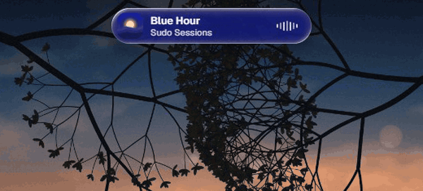
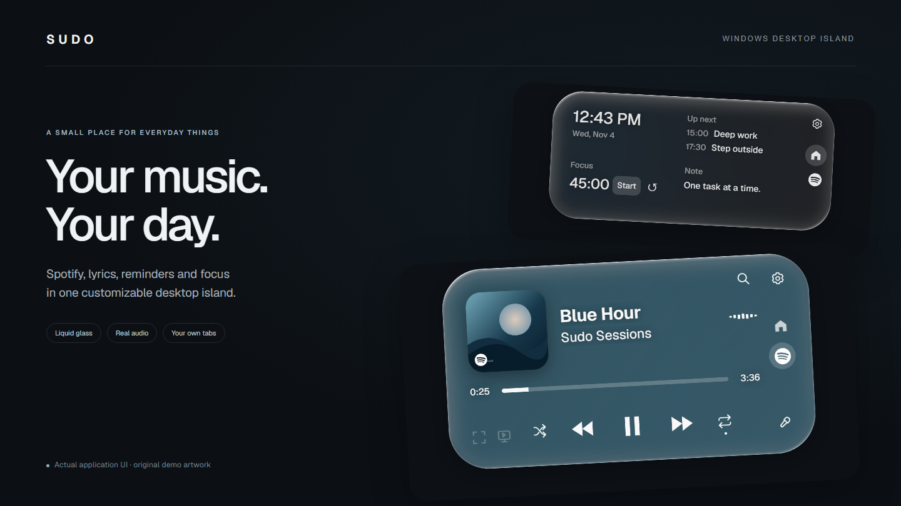
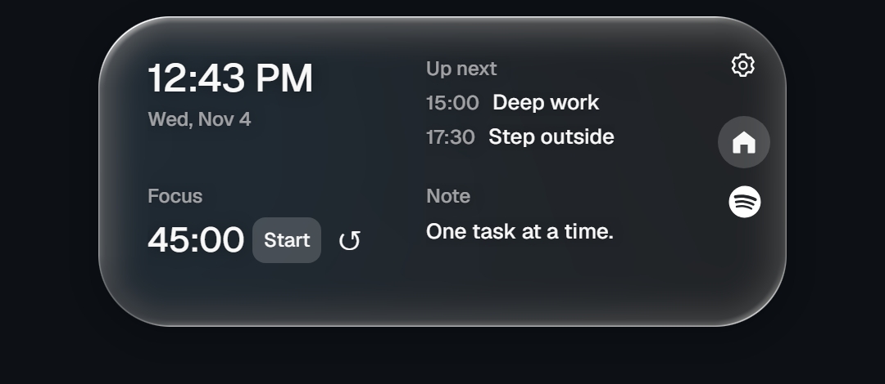
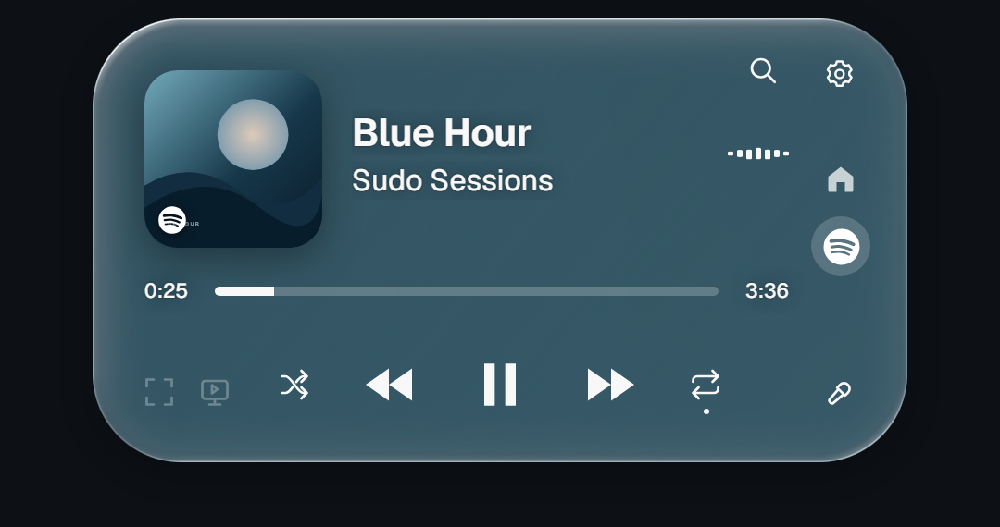
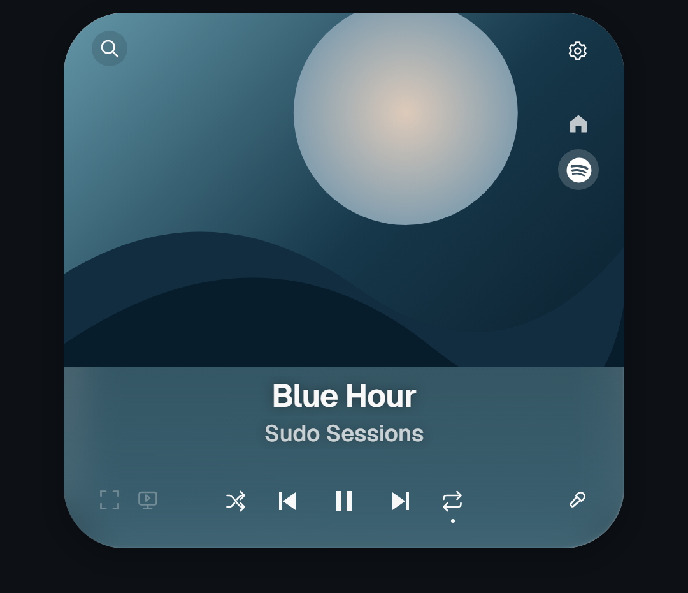
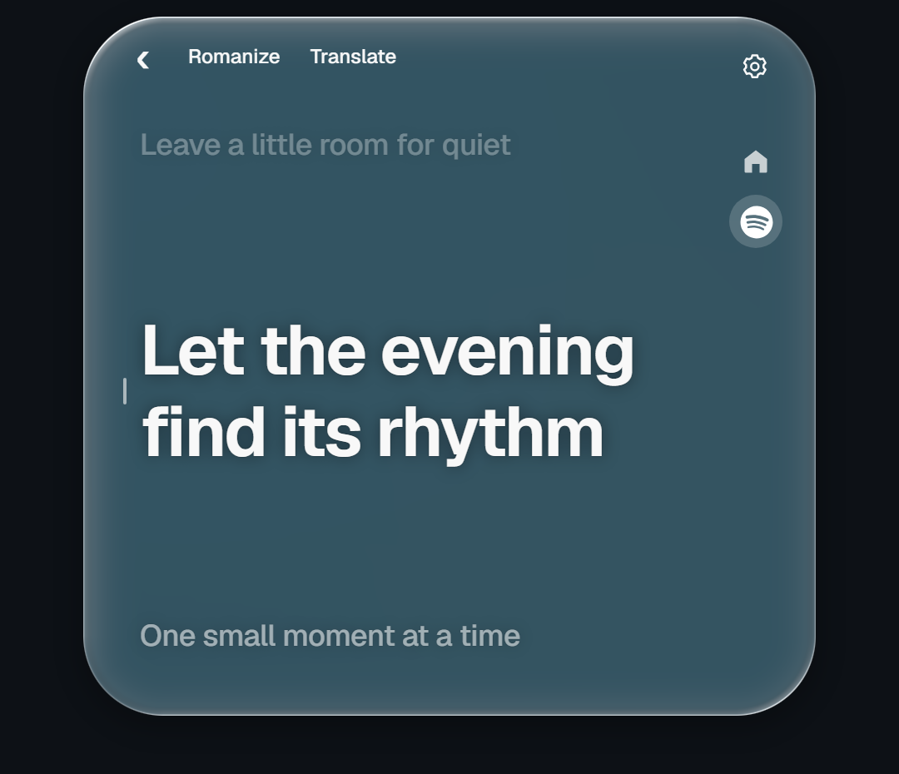
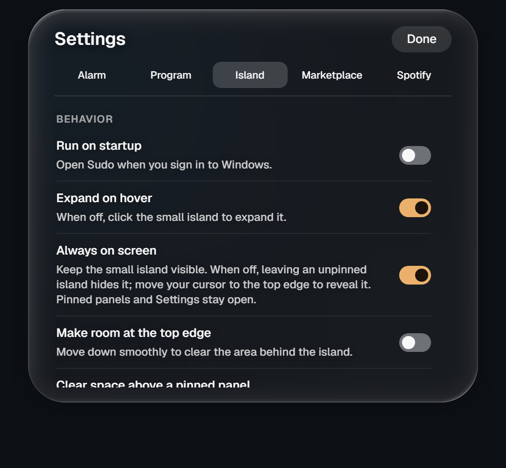
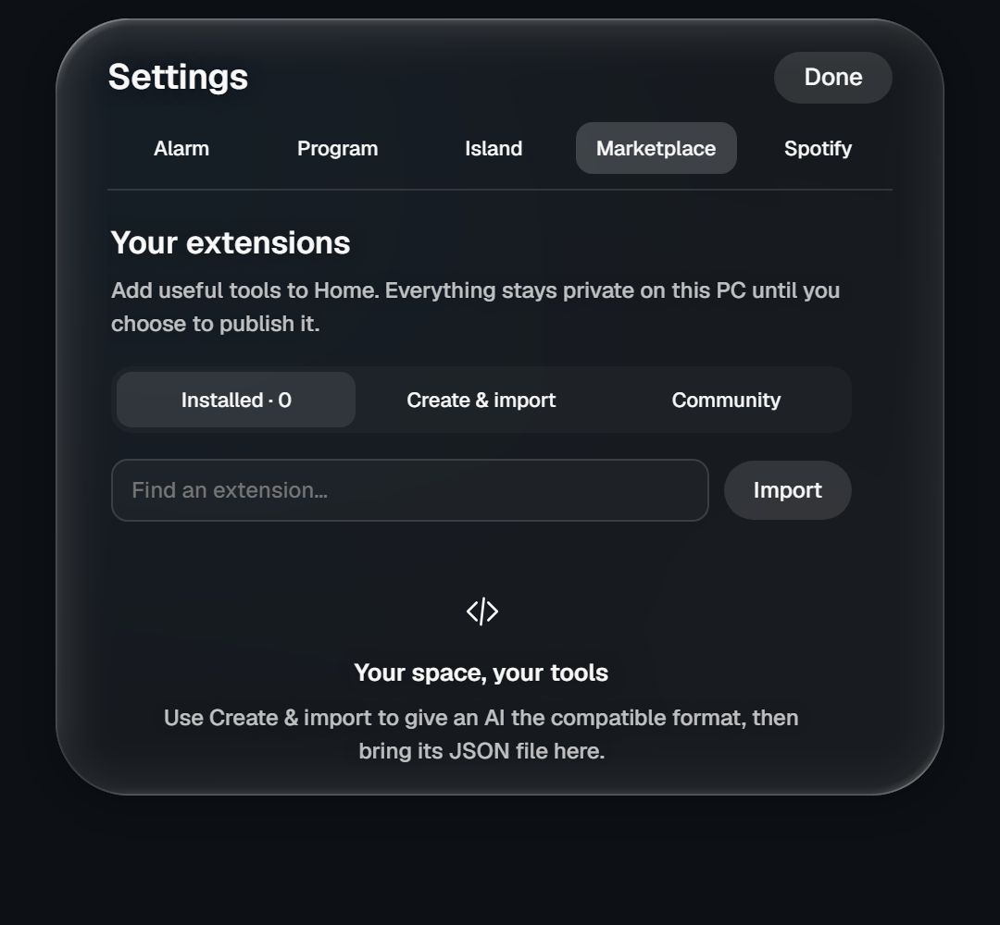

<div align="center">


# Sudo

### Music, focus and your day — at the top of your desktop.

A personal Windows island with liquid glass, Spotify controls, live lyrics, reminders and small extensions.

[](https://github.com/panmm942-ui/sudo-agent/actions/workflows/ci.yml)
[](https://github.com/panmm942-ui/sudo-agent/releases/latest)
[](https://github.com/panmm942-ui/sudo-agent/releases)

[](LICENSE)

**[Download for Windows](https://github.com/panmm942-ui/sudo-agent/releases/latest)** · **[Install in one command](#install)** · **[Features](#a-closer-look)** · **[FAQ](#faq)** · **[Build from source](#build-from-source)**



<sub>Recorded from the production interface with original demo artwork and lyrics; the native Spotify and desktop-capture layer is simulated for a repeatable capture (<a href="app/scripts/readme-demo/record.mjs">script</a>).</sub>

Windows x64 · Tauri + Svelte · ~5 MB installer · Native media controls · Optional local GPU features

</div>

---

## A little room for what matters

Sudo sits at the top of the screen as a compact island. Expand it for music or your next reminder, click to keep a panel open, then let it settle back when you leave. Its glass, borders, content and motion follow your preferences.

<p align="center"></p>

| Your music | Your day | Your space |
|:---|:---|:---|
| Spotify playback, real audio frequencies, lyrics and animated artwork. | A clock, weekly reminders, a focus timer and a personal note. | Glass and outline styles, configurable layouts, compact widgets and custom tabs. |

## Install

**One command** (PowerShell, no administrator rights needed):

```powershell
irm https://raw.githubusercontent.com/panmm942-ui/sudo-agent/master/scripts/install.ps1 | iex
```

The [script](scripts/install.ps1) downloads the latest installer from GitHub Releases, verifies it against the release's `SHA256SUMS.txt` and runs it. To review it first, or to get the portable build instead:

```powershell
irm https://raw.githubusercontent.com/panmm942-ui/sudo-agent/master/scripts/install.ps1 -OutFile install.ps1
.\install.ps1 -Portable        # or -DownloadOnly, or -Version v0.2.6
```

**Manual:** download `sudo-island_<version>_x64-setup.exe` (or the portable `.exe`) from the [latest release](https://github.com/panmm942-ui/sudo-agent/releases/latest). The executables are not code-signed yet, so SmartScreen may ask you to confirm; compare the file with `SHA256SUMS.txt` if you want to be sure.

### Requirements

| | |
|:--|:--|
| **OS** | Windows 11 x64 recommended; Windows 10 x64 (recent builds) |
| **Runtime** | Microsoft Edge WebView2: preinstalled on Windows 11; the installer sets it up on Windows 10 |
| **Spotify** | The Spotify **desktop app** for music features (the web player is not supported). No developer account needed for playback controls |
| **Optional** | Spotify Premium for search and the shuffle/repeat fallback; NVIDIA GPU + VB-CABLE for vocal mode; an iPhone for the Clock companion |

## Get started

1. Install Sudo (above). It appears as a small island at the top of the screen.
2. Open **Spotify desktop** and play a song. Sudo reads its Windows media session.
3. Move your pointer to the island to expand it. **Home** and **Spotify** are on the right; the gear opens **Settings**. The Spotify tab stays visible even when no song is available, with **Open Spotify** and **Retry** actions.
4. Open **Settings → Spotify** for layouts, visible controls, lyrics and video. Open **Settings → Island** for appearance, Home widgets and edge behavior.

Sudo opens once per Windows session, including when an installed and portable copy are launched together. To remove an installed copy, use **Settings → Island → Uninstall Sudo…** to open Windows Installed apps. A portable copy can be closed and its executable deleted.

## A closer look

<table>
<tr>
<td width="50%" valign="top">
<h3>Home, at your pace</h3>

<p>Choose your widgets. Keep a reminder nearby. Start a focus session without opening another app.</p>
</td>
<td width="50%" valign="top">
<h3>Music within reach</h3>

<p>Artwork-derived color, real playback state and the controls you choose to show.</p>
</td>
</tr>
<tr>
<td width="50%" valign="top">
<h3>Let the cover lead</h3>

<p>Four layouts: Centered, Artwork left, Wide player and Cover card. Animated backgrounds can take the place of the cover when enabled.</p>
</td>
<td width="50%" valign="top">
<h3>Stay with the words</h3>

<p>A focused three-line reader, with configurable type, spacing, context and motion.</p>
</td>
</tr>
</table>

<sub>These are captures of the application UI using original demo artwork and sample metadata. They illustrate the available layouts; music and lyric availability depend on their providers.</sub>

## Spotify, beyond play and pause

- **Native playback:** previous, play/pause and next; current title, artist, artwork, playback time and progress.
- **Choose your buttons:** show Repeat and Shuffle independently. Repeat cycles **Off → Repeat all → Repeat one → Off**. Controls reflect confirmed Spotify state. If Spotify ignores a Windows Shuffle/Repeat request, Sudo can use the saved Spotify connection as a verified playback fallback; Spotify Premium and playback permissions are required.
- **Real audio spectrum:** seven frequency bands from Spotify's actual process audio. Choose Classic, Spectrum or Fine bars, then tune sensitivity, smoothness and reactivity.
- **Four player layouts:** keep the original centered player, move artwork left, use the wide timeline layout or choose the large cover card. Colors come from the song artwork, with a neutral fallback.
- **Search inside the island:** the search icon replaces the player with Spotify catalogue results. Choose a song to request playback on the verified active Spotify device, without a separate search window. Account permissions, Premium playback access and provider rate limits apply; failures stay in the search view.
- **Lyrics:** timed lyrics when a matching LRCLIB record exists, plain lyrics when only text is available, and clear unavailable states.
- **Original Spotify covers:** use the running Spotify client’s largest cover or matching catalogue metadata, then test the public high-resolution CDN variant for the same artwork ID. A variant is accepted only when its actual image dimensions are larger; unavailable variants retain the original. The live client check decoded a 1500 × 1500 cover. Spotify provider retry deadlines are preserved across restarts.
- **Keep reading:** the lyric reader stays open when the pointer leaves. Close it, choose Home, or scroll back to leave the reader.
- **Resume the current video:** collapsing the island pauses and retains its resolved video and decoder. Reopening resumes against the song clock without repeating the lookup. Hidden playback checks stop, and changing the song or video settings releases the previous source. Small timing drift is corrected gently to keep frames flowing.

<details>
<summary><strong>Animated backgrounds and video quality</strong></summary>

Choose either **Animated album artwork**, fetched straight from Apple Music (motion covers where Apple has them, otherwise a 1200×1200 still), or an optional **Spotify Canvas** connection.

- Try artwork first, then Canvas if enabled, then keep the still cover and song color.
- Hide the cover only after video loads; restore it when no video can play.
- Select **Best available**, **2160p**, **1080p**, **720p** or **480p** for artwork streams. Single-file Canvas clips retain their original quality.
- Choose whether a silent video pauses with the song or continues looping.
- Use **Fullscreen now playing** at the lower left of the Spotify tab. Fullscreen keeps the sharp video centered over a live, screen-filling copy with 100 px blur, 65% darkening and soft side fades. Songs without a video use their artwork. Previous, Play/Pause and Next appear at the bottom center on mouse movement, then fade. The edge arrow switches to a square video or cover with controls underneath and lyrics on the right; the opposite arrow returns. The inline lyrics reader also has a **Fullscreen lyrics** button. Escape or the island’s fullscreen icon closes the view.
- Video phase comes from the song position modulo the clip duration, including seeks and late-opened views. Matching sources and accurate song timelines give both views the same reference; actual agreement between two computers depends on Spotify's reported position and decoder timing. Disabling pause-with-song allows the clip to continue during pauses.
- External video follows the track, quality and pause preferences even when the island is compact or showing Home. Without an external video view, video loading and decoding stop when the expanded Spotify panel is no longer visible.

Album animations and Canvas loops are separate from full Spotify music videos. Not every song or album has one. Artwork lookup sends artist, album and title metadata to its external service. Canvas is an unofficial, best-effort connection and requires a credential you explicitly save in Settings.

[Video options guide](docs/spotify-media-options.md) · [Canvas connection guide](docs/spotify-canvas.md)

</details>

<details>
<summary><strong>Lyrics, reading styles and languages</strong></summary>

Choose Spotlight, Balanced or Focus, then adjust font, alignment, scale, weight, spacing, surrounding-line emphasis, transition motion and timing offset. Long lines wrap inside the reader. The active line keeps its place as surrounding lines flow, including in fullscreen.

**Romanize** and **Translate** are mutually exclusive reader modes. Romanization uses local transliteration and may be approximate. Translation places smaller text under the original lines and uses MyMemory; visible lyric lines are sent to that service and quotas may apply. Missing language output falls back to the original lyric instead of hiding it.

Timing comes from the lyric provider. Sudo does not invent synchronized timestamps for plain-only lyrics.

**Built-in Spotify connection:** choose **Settings → Spotify → Set up Spotify connection**. Sudo installs only its small connector, keeps a restore backup and restarts Spotify once; no Spicetify CLI, theme or marketplace is required. It reads the current song ID, playback position, original covers, available Canvas and line-synced lyrics without catalogue search. Spotify’s matching timed lyrics take priority over LRCLIB. Your Spotify token stays inside Spotify. Temporary Canvas failures retry with bounded backoff; provider cooldowns remain effective. Use Repair after Spotify updates, or Restore previous Spotify setup to undo the connector. Initial setup supports the classic desktop Spotify download from spotify.com. Canvas is a short loop, separate from protected full-length music-video streams. See the [connector documentation](app/extensions/README.md).

</details>

<details>
<summary><strong>Optional account controls</strong></summary>

Basic playback and the audio spectrum use Spotify's Windows desktop session. An explicit Spotify connection powers optional Canvas backgrounds, catalogue search and player API fallback for shuffle/repeat. Playback API actions require the matching account and an active unrestricted device. Saved credentials stay in Windows Credential Manager and native memory.

Saved credentials stay in **Windows Credential Manager**, separate from normal preferences. Sudo does not automatically read browser cookies. Short-lived access tokens can expire; cookie exchange can stop working when Spotify changes its unofficial challenge. Missing access is shown in the app, and an action is not presented as successful until confirmed.

</details>

## Home, reminders and alarms

Choose from **Clock/date**, **Upcoming reminders**, **Focus timer** and **Personal note**. Change the focus duration, pause or reset it, and choose what the compact island displays. Home can keep its glass material or use the song's color/artwork.

The weekly program is yours to edit: create reminders, change times and weekdays, enable or disable entries, delete with Undo, or start with an empty program. The included initial routine is a personal example that can be replaced.

Alarms support recorded built-in sounds, your own audio file, volume, snooze and an optional gentle fade-in. Spotify can pause during an alarm and resume afterward when the same track is still selected. Alarm preview and test controls live in Settings.

### iPhone Clock connection

**Online companion:** pair your iPhone from **Settings → Alarm → Online iPhone companion** for access over mobile data or any Wi-Fi. It stores seven days of alarm coverage, shares the Home note and focus timer, receives text/links in your PC inbox, and accepts optional battery reports through Shortcuts. Native Clock imports still use the guided Shortcut. [Online setup, privacy and limitations](docs/online-companion.md).

An optional **Settings → Alarm → iPhone Clock** connection shares your upcoming routine with an iPhone Shortcut over your trusted local Wi-Fi. Scan the private setup QR and follow the guided Clock-action recipe on your phone. Each run refreshes one-shot Clock alarms for the next 24 hours, manages only the connection’s Sudo-labelled alarms, and reports an import separately from a schedule fetch. Configure daily and home-Wi-Fi Shortcut automations; run it again after changing your program.

The PC must be awake and Sudo running during sync. Once imported, Clock rings independently. Changes arrive on the next Shortcut run, not by instant push. iPhone sounds, volume, snooze and dismiss remain separate. Disabling the connection stops its LAN service but leaves previously imported phone alarms in Clock. No iCloud account, public server, or additional always-running process is required. [Setup and limitations](docs/iphone-clock.md).

## Make it yours

<table>
<tr>
<td width="50%" valign="top">

</td>
<td width="50%" valign="top">

</td>
</tr>
</table>

- **Appearance:** liquid glass, White outline, Pearl, Graphite or no border; independent darkness, transparency and background blur.
- **Quick presets:** Clear glass, Quiet glass and Fine outline apply existing appearance controls in one click. Fine-tune them afterward; your current appearance is saved automatically.
- **Home order:** add or remove Clock, Reminders, Focus and Note, then move enabled widgets up or down in Settings.
- **Interaction:** hover or click expansion, pinned panels, compact always-visible or edge-reveal behavior, and smooth top-edge clearance.
- **Compact mode:** select a Home widget or a preferred tab to keep in the small island.
- **Screenshot visibility:** keep the island visible in captures using a clean frozen backdrop; normal mode keeps live desktop refraction.
- **Startup and motion:** optional run-on-startup, interface sounds and reduced motion.
- **Updates:** check GitHub releases from Settings. Update checks link to the release page; signed automatic updating is not configured.

## Your own tabs and extensions

Import a compatible JSON package under **Settings → Marketplace**. Use the included authoring prompt to give an AI the extension format, environment and design requirements, then validate the generated package before adding it.

- Private/local by default; enable, disable, export or remove installed tabs.
- Custom icons appear on the left of Home; built-in navigation stays on the right.
- Interactive v2 tabs support sandboxed HTML, CSS and JavaScript, persistent extension state and declared network access.
- Optional credentials are stored separately through Windows Credential Manager.
- GitHub catalogue support can prepare a public issue draft. You review and submit it yourself; a public repository with Issues enabled is required.

Validation checks compatibility and declared capabilities. It does not guarantee that arbitrary third-party JavaScript is correct or efficient.

## Optional vocal reduction

Under **Settings → Spotify → Add vocal mode**, Sudo can prepare a local vocal-separation engine and expose a vocal-volume control. The ordinary island has no Python/model dependency.

This is an optional GPU feature: a compatible NVIDIA GPU, model/runtime downloads and VB-CABLE routing are needed. Setup can download its own portable runtime; driver installation still requires your administrator action and may require a restart. Processing adds delay, approximately 1.7 seconds in the engine's stated configuration, and separation quality varies.

[Optional vocal setup and requirements](app/src-tauri/resources/README-vocals.md)

## Build from source

Install Git, Node.js/npm, Rust/rustup and the Windows C++ build tools/SDK. Use a current Node version compatible with the locked Vite/Svelte toolchain. The environment script selects a data/cache location; it does not install these prerequisites.

```powershell
git clone https://github.com/panmm942-ui/sudo-agent.git
cd sudo-agent
. .\dev.ps1
rustup default stable
cd app
npm ci
npm run tauri -- dev
```

Create an optimized Windows installer:

```powershell
npm run tauri -- build --bundles nsis
```

Run the application checks:

```powershell
npm run check
npx vitest run
cargo test --manifest-path src-tauri/Cargo.toml --locked --features tauri/custom-protocol --lib
npx playwright test --config playwright.extensions.config.ts
```

<details>
<summary><strong>Repository map and experimental local AI core</strong></summary>

```text
app/       Svelte interface and Tauri Windows application
core/      Python local-AI experiments: transcription, routing and model clients
bench/     Benchmark tooling and measured/experimental model work
docs/      Setup guides, design notes and implementation records
```

The desktop voice interaction currently uses a **scripted demonstration**. The separate Python core includes local speech/model experiments and benchmarks, but it is not yet wired into a general-purpose voice assistant or automatic action executor in the running island. Model and GPU setup are separate from the desktop installer.

</details>

## Configuration

Everything is configured in the app; there are no config files to edit.

| Where | What |
|:--|:--|
| **Settings → Island** | Glass/outline style, darkness, transparency, blur, hover or click expansion, compact and edge-reveal modes, Home widgets, *Visible in screenshots*, run on startup, reduced motion, FPS display, updates, uninstall |
| **Settings → Spotify** | Player layout, visible buttons, spectrum style, lyrics reader, romanize/translate, video source and quality, Spotify connector, Canvas connection, vocal mode |
| **Settings → Alarm** | Alarm sound, volume, snooze, fade-in, pausing Spotify during alarms, iPhone Clock and online companion |
| **Settings → Program** | Weekly reminders |
| **Settings → Marketplace** | Import, enable, export and remove extensions |

Advanced: the `SUDO_DATA` environment variable moves Sudo's data folder (default `%LOCALAPPDATA%\Sudo\data`). Preferences live in the WebView profile under `%LOCALAPPDATA%\dev.sudo.island`; credentials live in Windows Credential Manager.

## FAQ

**Is this an official Spotify or Apple product?**
No. Sudo is an independent project, not affiliated with Spotify or Apple. "Dynamic Island" describes the interaction style.

**Does it need my Spotify password or a developer account?**
No. Playback controls, artwork and the spectrum use Windows' media session and Spotify's process audio. Optional features (Canvas, search) use a connection you set up explicitly; saved credentials stay in Windows Credential Manager, and the built-in connector keeps Spotify's own token inside Spotify.

**Does it work with Apple Music, YouTube Music or the Spotify web player?**
Not currently. The music panel is built around the Spotify desktop app.

**Does it send my data anywhere?**
Only what a feature needs, to the service that provides it: track metadata to LRCLIB/NetEase for lyrics and to artwork.m8tec.top for animated covers, visible lyric lines to MyMemory when Translate is on, and your alarm schedule to *your own* Cloudflare Worker if you deploy the online companion. Sudo has no analytics or telemetry; the update check (which you can turn off) only asks the GitHub API for the latest release.

**Why does Windows warn me when I run it?**
The binaries are not code-signed yet. Every release has SHA-256 checksums, and the install script verifies them.

**Can I build my own panels?**
Yes. Import a JSON extension under **Settings → Marketplace**; see [the extension format](app/extensions/README.md).

**Something's wrong.**
See [Troubleshooting](docs/TROUBLESHOOTING.md), then [open an issue](https://github.com/panmm942-ui/sudo-agent/issues/new/choose).

## Contributing

Bug reports, ideas and pull requests are welcome; read [CONTRIBUTING.md](CONTRIBUTING.md) first. Please follow the [Code of Conduct](CODE_OF_CONDUCT.md) and report security issues privately as described in [SECURITY.md](SECURITY.md). Release history is in [CHANGELOG.md](CHANGELOG.md).

## Project notes

Sudo is a personal project under active development. The Windows release is unsigned, and a clean-machine installer test remains separate from the local executable smoke test. Authenticated Canvas access and complete vocal processing are optional integrations with their own access and hardware requirements.

Artwork and lyrics come from their respective providers. Spotify is not affiliated with this project. Built-in sound attribution is recorded in [alarm sources](app/src/assets/alarms/sources.json); the Spotify asset's origin is recorded [here](app/src/assets/spotify-icon-source.md).

## License

Sudo is released under the [MIT License](LICENSE). Third-party services, downloaded models, FFmpeg and VB-CABLE keep their own terms; see the [vocal setup notes](app/src-tauri/resources/README-vocals.md) and [alarm sources](app/src/assets/alarms/sources.json).

---

<div align="center">

**[Get Sudo](https://github.com/panmm942-ui/sudo-agent/releases/latest)** · [Report an issue](https://github.com/panmm942-ui/sudo-agent/issues/new/choose) · [Troubleshooting](docs/TROUBLESHOOTING.md) · [Changelog](CHANGELOG.md)

</div>
